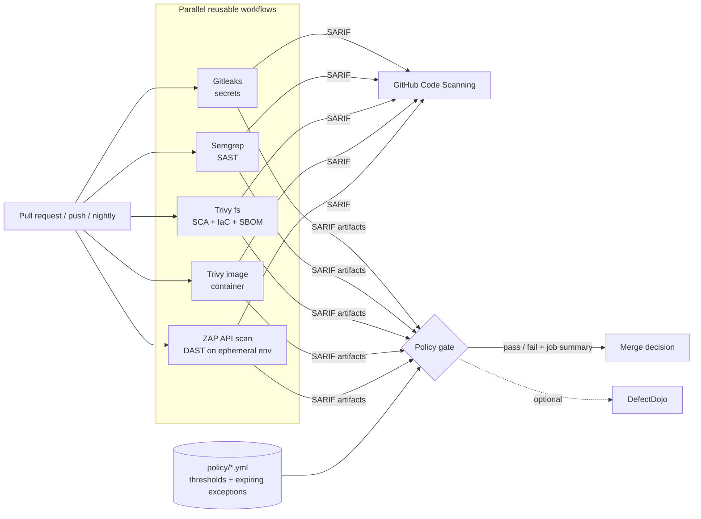

# DevSecOps Pipeline for GitHub

[](https://github.com/UrbanoEstevao/devsecops-pipeline/actions/workflows/appsec-pipeline.yml)

I built this to show how a full application security pipeline fits together on GitHub using only open source tools: secrets, SAST, SCA, container scanning and DAST, all feeding one gate that decides whether a PR can merge.

It's a portfolio project, but the workflows are reusable, so you can point your own repos at them.

> ⚠️ [`demo-app/`](demo-app/) is a deliberately vulnerable API that gives the pipeline real findings to catch. Don't deploy it. The bugs, the fake key and the old dependencies are all planted on purpose.



## What's in it

| Stage | Tool | Runs on | Notes |
|---|---|---|---|
| Secrets | [Gitleaks](https://github.com/gitleaks/gitleaks) | every PR / push | Full history on push, PR commits only on PRs |
| SAST | [Semgrep CE](https://github.com/semgrep/semgrep) | every PR / push | **Diff-aware** on PRs (`--baseline-commit`), so only new issues are reported |
| SCA | [Trivy](https://github.com/aquasecurity/trivy) `fs` + [Dependency Review](https://github.com/actions/dependency-review-action) | every PR / push | Trivy also scans IaC misconfigs and emits a CycloneDX **SBOM** |
| Container | Trivy `image` | every PR / push | Image built in the runner, never pushed. Also emits an image SBOM |
| DAST | [ZAP](https://www.zaproxy.org/) API scan | every PR / push | App runs in an **ephemeral docker compose env** and is driven by its OpenAPI spec. Optional auth header |
| Gate | [`scripts/gate.py`](scripts/gate.py) | after all scanners | Normalises severities across tools and applies the policy |
| Tracking | [DefectDojo](https://github.com/DefectDojo/django-DefectDojo) | optional | Re-import with dedup and auto-close of fixed findings |

## Why it works this way

- **PR scans only report what the PR changes.** If you dump every old finding on a developer, they'll turn the gate off within a week. The full scan runs on `main` and nightly.
- **Warn first, enforce later.** The demo policy is in `warn` mode so the repo stays green. Flip it to `enforce` and the gate blocks the PR.
- **One format for everything.** Every tool outputs SARIF, and a small script converts ZAP's report, so DAST findings land in the same place as the rest.
- **Exceptions expire.** A risk acceptance needs a reason, an owner and a date, so it can't sit in the config forever.

### Securing the pipeline itself

A security pipeline that can be hijacked is worse than none, so I treated the workflows like production code:

- Every third-party action is pinned to a full commit SHA. Mutable tags have been hijacked before (`tj-actions/changed-files`, 2025), and Dependabot keeps the pins current.
- Scanner binaries are checked against a pinned SHA-256 before they run.
- Each job gets the minimum `permissions:`, and checkouts use `persist-credentials: false`.
- Workflow inputs reach shell scripts only through `env:`, never through `${{ }}` inside `run:`, which closes the script-injection hole.
- The vulnerable app binds to `127.0.0.1` inside the runner and is torn down after the scan.

## Use it in your repo

```yaml
# .github/workflows/appsec.yml in any repository
name: AppSec
on: [pull_request, push]
permissions: { contents: read }

jobs:
  secrets:
    uses: UrbanoEstevao/devsecops-pipeline/.github/workflows/secrets.yml@v1
    permissions: { contents: read, security-events: write }
  sast:
    uses: UrbanoEstevao/devsecops-pipeline/.github/workflows/sast.yml@v1
    permissions: { contents: read, security-events: write }
  sca:
    uses: UrbanoEstevao/devsecops-pipeline/.github/workflows/sca.yml@v1
    permissions: { contents: read, security-events: write, pull-requests: write }
  dast:
    uses: UrbanoEstevao/devsecops-pipeline/.github/workflows/dast.yml@v1
    permissions: { contents: read, security-events: write }
    with:
      compose-file: docker-compose.yml
      openapi-url: http://localhost:8080/v3/api-docs
      target-url: http://localhost:8080
      toolkit-repository: UrbanoEstevao/devsecops-pipeline
      toolkit-ref: v1
    secrets:
      dast-auth-header: ${{ secrets.DAST_AUTH_HEADER }} # "Authorization: Bearer ..."
  gate:
    needs: [secrets, sast, sca, dast]
    if: always()
    uses: UrbanoEstevao/devsecops-pipeline/.github/workflows/gate.yml@v1
    with:
      toolkit-repository: UrbanoEstevao/devsecops-pipeline
      toolkit-ref: v1
```

The caller's `policy/security-policy.yml` is used if it exists. Otherwise the toolkit default applies.

## What the demo app triggers

| Planted issue | Caught by |
|---|---|
| Hardcoded secret (`app.py`) | Gitleaks, Semgrep |
| SQL injection (`/api/users`) | Semgrep, ZAP |
| Reflected XSS (`/api/greet`) | Semgrep, ZAP |
| OS command injection (`/api/lookup`) | Semgrep, ZAP |
| Unsafe YAML deserialization (`/api/import`) | Semgrep |
| Vulnerable deps (PyYAML 5.3.1, Werkzeug 2.0.2, ...) | Trivy fs, Dependency Review |
| EOL base image (`python:3.9-slim`), runs as root | Trivy image / misconfig |
| Missing security headers | ZAP |

The demo uses [`policy/demo-app-policy.yml`](policy/demo-app-policy.yml) in `warn` mode so the
repo stays green while still reporting everything. Set it to `enforce` to watch the gate block.

## Setup notes

- **Code scanning upload** works on public repos for free. Private repos need GitHub Advanced
  Security. Uploads use `continue-on-error`, and the gate works either way.
- **DefectDojo**: add the `DEFECTDOJO_URL` and `DEFECTDOJO_TOKEN` repo secrets to enable it.
- **Branch protection**: Make gate / Policy gate a required status check in your ruleset, so a failing gate actually blocks merges.

## Known limitations

- The Trivy image scan counts one finding per affected package, and the demo's end-of-life base image inflates the totals. `--ignore-unfixed` and unique-CVE counts are next.
- DAST runs unauthenticated. The auth header option exists, but I haven't tested it against a real login.
- I've only run it against the one demo app, so expect to tune it for yours.

## Roadmap

- [ ] CodeQL as a second SAST engine for compiled languages
- [ ] Sign images and SBOMs with Sigstore cosign, plus SLSA provenance attestations
- [ ] Authenticated DAST with a scripted login (ZAP Automation Framework)
- [ ] OPA/Conftest checks for Kubernetes and Terraform
- [ ] EPSS/KEV enrichment in the gate (prioritise exploited CVEs)
