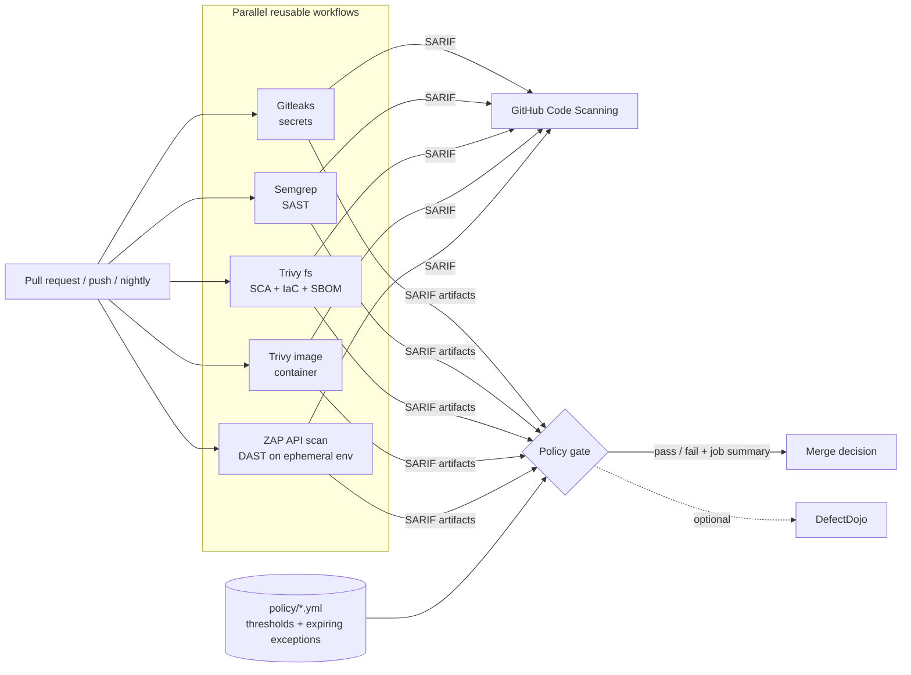

# DevSecOps Pipeline for GitHub (100% open source)

[](https://github.com/UrbanoEstevao/devsecops-pipeline/actions/workflows/appsec-pipeline.yml)

A reusable, policy-driven application security pipeline for GitHub Actions.
SAST, SCA, secret scanning, container scanning and DAST all report into one
format (SARIF), one place (GitHub code scanning, plus DefectDojo as an option) and one
**policy-as-code gate** that decides whether a build ships.

A deliberately vulnerable API in [`demo-app/`](demo-app/) gives the pipeline
real findings to catch.

> ⚠️ `demo-app/` is **intentionally vulnerable** and exists only to give the pipeline real findings to catch. Don't deploy it. Its Dependabot alerts and the hardcoded key are planted on purpose.



## What's in it

| Stage | Tool | Runs on | Notes |
|---|---|---|---|
| Secrets | [Gitleaks](https://github.com/gitleaks/gitleaks) | every PR / push | Full history on push, PR commits only on PRs |
| SAST | [Semgrep CE](https://github.com/semgrep/semgrep) | every PR / push | **Diff-aware** on PRs (`--baseline-commit`), so only new issues are reported |
| SCA | [Trivy](https://github.com/aquasecurity/trivy) `fs` + [Dependency Review](https://github.com/actions/dependency-review-action) | every PR / push | Trivy also scans IaC misconfigs and emits a CycloneDX **SBOM** |
| Container | Trivy `image` | every PR / push | Image built in the runner, never pushed. Also emits an image SBOM |
| DAST | [ZAP](https://www.zaproxy.org/) API scan | every PR / push | App runs in an **ephemeral docker compose env** and is driven by its OpenAPI spec. Optional auth header |
| Gate | [`scripts/gate.py`](scripts/gate.py) | after all scanners | Normalises severities across tools and applies the policy |
| Tracking | [DefectDojo](https://github.com/DefectDojo/django-DefectDojo) | optional | Re-import with dedup and auto-close of fixed findings |

## Design decisions

- **Reusable workflows (`workflow_call`).** Each scanner is its own workflow. Any repo adopts the
  whole pipeline in about 30 lines, and the AppSec team upgrades tools in one place.
- **SARIF everywhere.** Every tool outputs SARIF. ZAP doesn't, so
  [`zap_to_sarif.py`](scripts/zap_to_sarif.py) converts it, which puts DAST findings in the same
  Security tab as SAST.
- **Severity normalisation.** Tools disagree on severity. The gate uses `security-severity`
  (CVSS-like) when a tool provides it and falls back to SARIF `level` otherwise. Per-tool overrides
  are allowed, for example *every leaked secret is critical*.
- **Policy-as-code with expiring exceptions.** Risk acceptances live in git with a reason, an owner
  and an expiry date. Expired waivers stop applying automatically and are flagged.
- **Warn → enforce rollout.** `mode: warn` reports without blocking, so teams can adopt the
  pipeline without stopping delivery and then flip to `enforce`.
- **Developer experience.** PR scans are diff-aware and parallel, results show up as inline PR
  annotations, and the gate writes a readable job summary.

### Pipeline hardening (securing the pipeline itself)

- Every third-party action is **pinned to a full commit SHA** (mutable tags have been hijacked
  before, e.g. `tj-actions/changed-files` in 2025). Dependabot keeps the pins current.
- Scanner binaries are downloaded and **verified against a pinned SHA-256** before they run.
- **Least-privilege `permissions:`** per job, and `persist-credentials: false` on every checkout.
- Workflow inputs reach shell scripts only through `env:`, never interpolated with `${{ }}`
  inside `run:`, which **prevents script injection**.
- The vulnerable app runs bound to `127.0.0.1` inside the runner and is torn down after the scan.

## Use it in your repo

```yaml
# .github/workflows/appsec.yml in any repository
name: AppSec
on: [pull_request, push]
permissions: { contents: read }

jobs:
  secrets:
    uses: UrbanoEstevao/devsecops-pipeline/.github/workflows/secrets.yml@v1
    permissions: { contents: read, security-events: write }
  sast:
    uses: UrbanoEstevao/devsecops-pipeline/.github/workflows/sast.yml@v1
    permissions: { contents: read, security-events: write }
  sca:
    uses: UrbanoEstevao/devsecops-pipeline/.github/workflows/sca.yml@v1
    permissions: { contents: read, security-events: write, pull-requests: write }
  dast:
    uses: UrbanoEstevao/devsecops-pipeline/.github/workflows/dast.yml@v1
    permissions: { contents: read, security-events: write }
    with:
      compose-file: docker-compose.yml
      openapi-url: http://localhost:8080/v3/api-docs
      target-url: http://localhost:8080
      toolkit-repository: UrbanoEstevao/devsecops-pipeline
      toolkit-ref: v1
    secrets:
      dast-auth-header: ${{ secrets.DAST_AUTH_HEADER }} # "Authorization: Bearer ..."
  gate:
    needs: [secrets, sast, sca, dast]
    if: always()
    uses: UrbanoEstevao/devsecops-pipeline/.github/workflows/gate.yml@v1
    with:
      toolkit-repository: UrbanoEstevao/devsecops-pipeline
      toolkit-ref: v1
```

The caller's `policy/security-policy.yml` is used if it exists. Otherwise the toolkit default applies.

## What the demo app should trigger

| Planted issue | Caught by |
|---|---|
| Hardcoded secret (`app.py`) | Gitleaks, Semgrep |
| SQL injection (`/api/users`) | Semgrep, ZAP |
| Reflected XSS (`/api/greet`) | Semgrep, ZAP |
| OS command injection (`/api/lookup`) | Semgrep, ZAP |
| Unsafe YAML deserialization (`/api/import`) | Semgrep |
| Vulnerable deps (PyYAML 5.3.1, Werkzeug 2.0.2, ...) | Trivy fs, Dependency Review |
| EOL base image (`python:3.9-slim`), runs as root | Trivy image / misconfig |
| Missing security headers | ZAP |

The demo uses [`policy/demo-app-policy.yml`](policy/demo-app-policy.yml) in `warn` mode so the
repo stays green while still reporting everything. Set it to `enforce` to watch the gate block.

## Setup notes

- **Code scanning upload** works on public repos for free. Private repos need GitHub Advanced
  Security. Uploads use `continue-on-error`, and the gate works either way.
- **DefectDojo**: add the `DEFECTDOJO_URL` and `DEFECTDOJO_TOKEN` repo secrets to enable it.
- **Branch protection**: make the `gate / Policy gate` check required on `main`.

## Roadmap

- [ ] CodeQL as a second SAST engine for compiled languages
- [ ] Sign images and SBOMs with Sigstore cosign, plus SLSA provenance attestations
- [ ] Authenticated DAST with a scripted login (ZAP Automation Framework)
- [ ] OPA/Conftest checks for Kubernetes and Terraform
- [ ] EPSS/KEV enrichment in the gate (prioritise exploited CVEs)